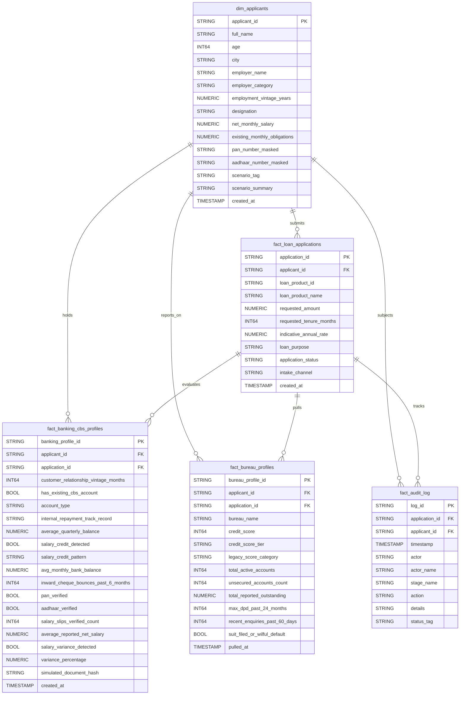

# Punjab National Bank · Intelligent Lending Presales POC
## BigQuery Minimum Viable Schema & Seed Data (Phase 1)

This directory contains the BigQuery SQL DDL definitions, relational integrity validation script, and generated seed data for the 3 curated synthetic applicant personas (**Priya Sharma**, **Rajesh Kumar**, and **Amit Verma**).

---

## 1. Overview of Minimum Viable Tables

Phase 1 establishes the **5 core tables** required to store normalized banking facts and power the 7-stage loan workflow:

| Table Name | Type | Partitioning / Clustering | Description |
| :--- | :--- | :--- | :--- |
| **`dim_applicants`** | Dimension | Clustered by `scenario_tag, city` | Core applicant master: demographics, employer info, salary, existing obligations, masked KYC identifiers. |
| **`fact_loan_applications`** | Fact | Partitioned by `DATE(created_at)`, Clustered by `application_status, applicant_id` | Loan application intake record: requested principal, tenure, rate, purpose, and lifecycle status. |
| **`fact_banking_cbs_profiles`** | Fact | Clustered by `applicant_id, account_type` | Consolidated Core Banking (CBS) metrics, Account Aggregator (AA) cashflow behaviors, and synthetic document verification tokens. |
| **`fact_bureau_profiles`** | Fact | Clustered by `applicant_id, credit_score_tier` | Mock credit bureau inquiries (CIBIL), scores, delinquency history (DPD), active tradelines, and enquiry counts. |
| **`fact_audit_log`** | Fact (Append-only) | Partitioned by `DATE(timestamp)`, Clustered by `application_id, actor` | Append-only maker-checker governance and system orchestrator action audit trail. |

---

## 2. Entity-Relationship & Key Architecture



---

## 3. How to Run the Generator & Validator

From the project root:

```bash
python3 bigquery/generate_seed_data.py
```

### Generated Artifacts
1. **Newline-Delimited JSON (NDJSON) Files** in `bigquery/seeds/`:
   - `dim_applicants.json`
   - `fact_loan_applications.json`
   - `fact_banking_cbs_profiles.json`
   - `fact_bureau_profiles.json`
   - `fact_audit_log.json`
2. **ANSI SQL Insert Script**:
   - `bigquery/seeds.sql` (can be executed directly in the BigQuery Console)

---

## 4. Automated Integrity Validations Implemented

The generator script executes 43 automated verification checks before producing outputs:

1. **Primary Key Uniqueness:** Verifies zero duplicates across `applicant_id`, `application_id`, `banking_profile_id`, `bureau_profile_id`, and `log_id`.
2. **NOT NULL Completeness:** Ensures no required columns contain null, empty, or whitespace-only values.
3. **Foreign Key Integrity:** Ensures zero orphaned records across `dim_applicants` and `fact_loan_applications`.
4. **Credit Score Boundaries & Tiers:**
   - Validates scores remain within the standard 300–900 scale.
   - Enforces the authoritative policy tiers:
     - **`PRIME`**: CIBIL $\ge 720$ (Priya: 785)
     - **`NEAR_PRIME_REVIEW`**: $675 \le \text{CIBIL} \le 719$ (Rajesh: 690)
     - **`SUBPRIME_HIGH_RISK`**: CIBIL $< 675$ (Amit: 585)
5. **Exact Financial Calculations:**
   - Evaluates the reducing-balance EMI formula:
     $$\text{EMI} = \frac{P \cdot r \cdot (1 + r)^n}{(1 + r)^n - 1}$$
     - Priya: ₹16,548
     - Rajesh: ₹21,512
     - Amit: ₹14,087
   - Evaluates Fixed Obligation to Income Ratio (FOIR):
     $$\text{FOIR} = \left( \frac{\text{Existing Obligations} + \text{Proposed EMI}}{\text{Net Salary}} \right) \times 100$$
     - Priya: 30.1% (within 50% limit)
     - Rajesh: 73.1% (breaches 50% limit)
     - Amit: 102.7% (exceeds total monthly income)

---

## 5. BigQuery Provisioning Instructions (When Approved)

### Option A: Using the Google Cloud Web Console
1. Open the [Google Cloud BigQuery Console](https://console.cloud.google.com/bigquery).
2. Create dataset `pnb_intelligent_lending` in your desired region (e.g. `asia-south1`).
3. Run the DDL script in `bigquery/schema.sql` to create all 5 tables.
4. Run `bigquery/seeds.sql` in the Query Editor to insert the seed data.

### Option B: Using the `bq` Command-Line Tool
```bash
# 1. Create dataset
bq --location=asia-south1 mk -d pnb_intelligent_lending

# 2. Run DDL
bq query --use_legacy_sql=false < bigquery/schema.sql

# 3. Load NDJSON tables
bq load --source_format=NEWLINE_DELIMITED_JSON pnb_intelligent_lending.dim_applicants bigquery/seeds/dim_applicants.json
bq load --source_format=NEWLINE_DELIMITED_JSON pnb_intelligent_lending.fact_loan_applications bigquery/seeds/fact_loan_applications.json
bq load --source_format=NEWLINE_DELIMITED_JSON pnb_intelligent_lending.fact_banking_cbs_profiles bigquery/seeds/fact_banking_cbs_profiles.json
bq load --source_format=NEWLINE_DELIMITED_JSON pnb_intelligent_lending.fact_bureau_profiles bigquery/seeds/fact_bureau_profiles.json
bq load --source_format=NEWLINE_DELIMITED_JSON pnb_intelligent_lending.fact_audit_log bigquery/seeds/fact_audit_log.json
```
